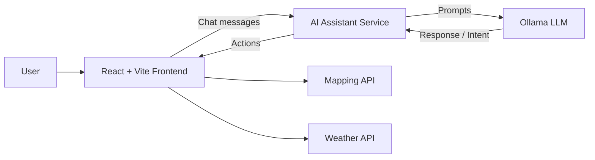

<div align="center">

# 🇮🇳 TOURTEC INDIA — Smart Tourism & Geospatial Intelligence

**An AI-powered tourism platform for discovering destinations, exploring interactive maps, and planning trips across India, controlled through a natural-language chatbot.**

[](https://tourtec-frontend-dxbk.onrender.com/)


[**Live Demo**](https://tourtec-frontend-dxbk.onrender.com/) · [**Report a Bug**](https://github.com/YOUR_USERNAME/tourtec/issues) · [**Request a Feature**](https://github.com/YOUR_USERNAME/tourtec/issues)

</div>

---

## 📖 Table of Contents

- [Overview](#-overview)
- [Key Features](#-key-features)
- [Screenshots](#-screenshots)
- [Tech Stack](#-tech-stack)
- [Architecture](#-architecture)
- [Getting Started](#-getting-started)
- [Running with Docker](#-running-with-docker)
- [Environment Variables](#-environment-variables)
- [Project Structure](#-project-structure)
- [Roadmap](#-roadmap)
- [Author](#-author)

---

## 🌏 Overview

**TOURTEC INDIA** (*अतुल्य भारत*) is a smart tourism suite that helps travellers discover destinations, explore them on interactive maps, and plan trips with location-aware information such as live weather.

What sets it apart is its **AI assistant**: a chatbot powered by a **Large Language Model served locally through Ollama** that understands natural-language requests and **controls features across the entire website**, so users can get things done by simply asking.

The application and its AI service are **containerized with Docker** for consistent, portable setup and deployment.

---

## ✨ Key Features

- 🤖 **AI Chatbot Assistant** — Ask in plain language; the assistant interprets the request and drives the website's features for you.
- 🗺️ **Interactive Maps** — Explore destinations visually with geospatial data.
- 🧭 **Destination Discovery** — Browse and find places across India.
- 🌤️ **Weather Integration** — Location-aware weather to help plan the best time to visit.
- 📅 **Trip Planning Workflows** — Organize destinations into a structured travel plan.
- 🐳 **Dockerized Setup** — Run the app and AI service anywhere with consistent behaviour.
- 📱 **Responsive Design** — Works across desktop and mobile screens.

---

## 📸 Screenshots

> Replace these placeholders with real screenshots (save them in a `docs/screenshots/` folder).

| Home | Interactive Map |
| :---: | :---: |
|  |  |

| AI Chatbot | Trip Planner |
| :---: | :---: |
|  |  |

---

## 🛠️ Tech Stack

| Layer | Technologies |
| --- | --- |
| **Frontend** | React.js, Vite, JavaScript, HTML5, CSS3 |
| **AI / LLM** | Ollama (local LLM serving), chatbot with natural-language control |
| **APIs** | Mapping API, Weather API |
| **DevOps** | Docker |
| **Hosting** | Render |

---

## 🏗️ Architecture



> Adjust this diagram to match your exact setup (for example, if you have a separate backend service between the frontend and Ollama).

---

## 🚀 Getting Started

### Prerequisites

- [Node.js](https://nodejs.org/) 18 or later
- [Git](https://git-scm.com/)
- [Ollama](https://ollama.com/) (for the AI assistant)
- API keys for the mapping and weather services you use

### Installation

```bash
# 1. Clone the repository
git clone https://github.com/YOUR_USERNAME/tourtec.git
cd tourtec

# 2. Install dependencies
npm install

# 3. Create your environment file
cp .env.example .env
# then fill in your API keys (see Environment Variables below)

# 4. Start the development server
npm run dev
```

The app will be available at `http://localhost:5173`.

### Set up the AI assistant

```bash
# Install Ollama, then pull the model you use
ollama pull YOUR_MODEL_NAME

# Make sure the Ollama server is running
ollama serve
```

---

## 🐳 Running with Docker

```bash
# Build and start all services
docker compose up --build

# Run in the background
docker compose up -d --build

# Stop everything
docker compose down
```

> If you don't use Docker Compose, replace this with your `docker build` and `docker run` commands.

---

## 🔐 Environment Variables

Create a `.env` file in the project root. Never commit real keys to GitHub.

```env
VITE_MAPS_API_KEY=your_maps_api_key
VITE_WEATHER_API_KEY=your_weather_api_key
VITE_AI_API_URL=http://localhost:11434
```

> Use the exact variable names from your code. Add a `.env.example` file with empty values so others know what to set.

---

## 📂 Project Structure

```text
tourtec/
├── public/              # Static assets
├── src/
│   ├── components/      # Reusable UI components
│   ├── pages/           # Application pages
│   ├── services/        # API and AI integration
│   ├── App.jsx
│   └── main.jsx
├── Dockerfile
├── docker-compose.yml
├── package.json
└── README.md
```

> Update this tree to match your real folders.

---

## 🗺️ Roadmap

- [ ] Add Retrieval-Augmented Generation (RAG) so the chatbot answers from a tourism knowledge base
- [ ] Personalized itinerary generation
- [ ] Multi-language support for regional Indian languages
- [ ] User accounts and saved trips
- [ ] Offline-friendly maps

---

## ⚠️ Note on the Live Demo

The live demo is hosted on Render. On free plans the server may sleep when idle, so the **first load can take 30–60 seconds**. Please wait for it to wake up.

---

## 👤 Author

**Jogendra Sai**
B.Tech Computer Science and Engineering, KL University

[](https://linkedin.com/in/YOUR_PROFILE)
[](https://github.com/YOUR_USERNAME)
[](mailto:jogendrasai780@gmail.com)

---

<div align="center">
⭐ If you like this project, please consider giving it a star!
</div>
